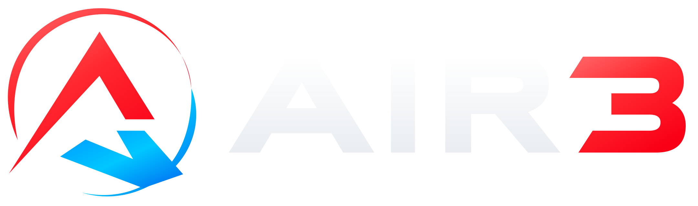
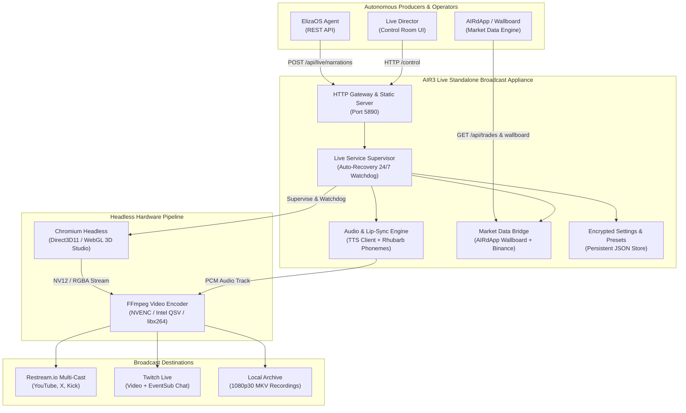
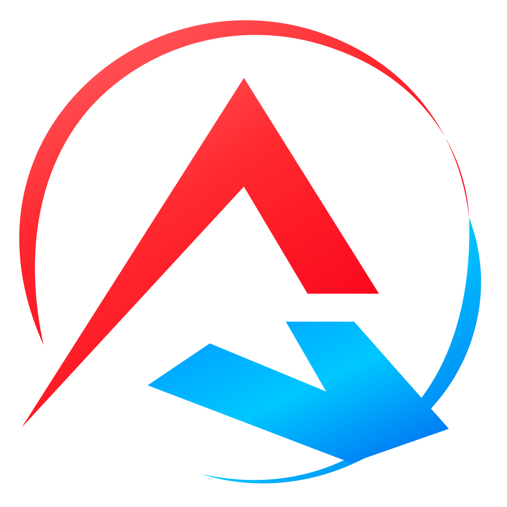

<p align="center">
  
</p>

<p align="center">
  <strong>Attiva una volta. Trasmetti per sempre.</strong><br>
  <em>Autonomous 24/7 Live Broadcast Studio — 3D MetaHuman Presenter, Market Wallboard, Headless Audio/Video Pipeline & Agent Control APIs</em>
</p>

<p align="center">
  <a href="#quickstart"><strong>🚀 Quickstart</strong></a> ·
  <a href="#executive-summary">Executive Summary</a> ·
  <a href="#at-a-glance">At a Glance</a> ·
  <a href="docs/AI_AGENT_GUIDE.md"><strong>🤖 AI Agent Guide</strong></a> ·
  <a href="#247-autonomous-architecture">24/7 Autonomous Architecture</a> ·
  <a href="#control-room">Control Room</a> ·
  <a href="#airdapp-wallboard">AIRdApp Wallboard</a> ·
  <a href="#rest-api-reference">REST APIs (ElizaOS & AIRdApp)</a> ·
  <a href="#hardware-acceleration">Hardware Acceleration</a> ·
  <a href="#license">License</a>
</p>

<p align="center">
  
  
  
  
  
  
  
  
</p>

---

## Executive Summary

**AIR3 Live** is an enterprise-grade, standalone 24/7 autonomous live broadcasting system engineered for the AIR3 virtual presenter. It unifies a real-time WebGL MetaHuman 3D stage, live financial market intelligence wallboards, continuous phonetic lip-sync synthesis, and a headless Chromium-to-FFmpeg hardware video pipeline into an unattended, self-healing streaming appliance.

Designed from the ground up for continuous perpetual streaming, **AIR3 Live is launched once and remains active indefinitely without human supervision**. A multi-tier auto-recovery supervisor automatically detects network packet drops, platform disconnection, or driver stalls and instantaneously restores the broadcast pipeline with persistent presets. Human directors and autonomous agents (such as **ElizaOS** and **AIRdApp**) can pilot the studio dynamically via high-performance REST and WebSocket APIs.

---

## At a Glance

- **24/7 Perpetual Autonomous Streaming** — Built-in watchdog supervisor with exponential backoff auto-reconnects and self-heals after network drops, encoder errors, or system sleep.
- **Production-Locked 3D MetaHuman Rig** — Shipped in full broadcast styling: cream off-shoulder crop top, relaxed low-cut boots, wavy chestnut hair, warm 5-point studio lighting, and expressive micro-facial emotions.
- **Active Camera Eye Tracking & Natural Roaming** — Neck, head, and gaze dynamically track the active camera lens across all shot transitions, blended with natural breathing, weight shifting, and human motion captures.
- **Native AIRdApp Wallboard Feed** — Central curved video wall directly connected to the official [AIRdApp Wallboard](https://airdapp.airewardrop.xyz/wallboard), rendering live trade signals, OHLCV candle charts, PnL ratios, and open/pending execution orders.
- **Phonetic Rhubarb Lip-Sync & Universal TTS** — OpenAI audio/speech API compatibility (/v1) with phoneme-level viseme alignment, speech queue management, and audio clock synchronization.
- **Multi-Platform Syndication** — Native output to Restream.io (multi-streaming to YouTube, Kick, X, Facebook simultaneously), direct Twitch ingest with read-only chat integration, and custom RTMP/RTMPS destinations.
- **Dual Hardware Acceleration** — Zero-copy WebGL GPU rendering with certified support for NVIDIA NVENC and Intel Arc / Core Ultra Quick Sync Video (QSV).
- **Zero Eliza / AiRDapp Code Coupling** — Standalone architecture communicating exclusively via clean, standardized HTTP REST and WebSocket contracts.

---

## Architecture



---

## Quickstart

### Prerequisites
- **Node.js**: version `24.0.0` or higher (`node -v`).
- **FFmpeg**: installed and available in system `PATH` (`ffmpeg -version`).
- **GPU**: NVIDIA RTX/GTX (NVENC) or Intel Arc / Intel Core Ultra (Quick Sync Video).

### Installation
Clone the repository and install runtime dependencies:
```bash
git clone https://github.com/0xfunboy/air3live.git
cd air3live
npm run setup
```

### One-Click Launchers (Windows)
| Batch File | Description |
| :--- | :--- |
| `start-all.bat` | **Recommended**. Launches the live control room and 3D studio, auto-detecting hardware GPU. |
| `start-nvidia.bat` | Launches studio prioritized on NVIDIA GPU (NVENC hardware encoder). |
| `start-intel.bat` | Launches studio prioritized on Intel Arc GPU (Quick Sync Video encoder). |
| `open-recordings.bat` | Instantly opens the folder containing local 1080p broadcast recordings. |

### CLI Launch
```bash
# Start standalone live gateway and launch operator windows
npm run live

# Run with explicit GPU affinity
npm run start:nvidia
npm run start:intel

# Run test suite (216 tests)
npm test
```

---

## 24/7 Autonomous Architecture

AIR3 Live is engineered for perpetual unattended operation. Unlike conventional studio tools that stop on unexpected pipe exits, AIR3 Live includes an autonomous watchdog loop:

1. **Continuous Stream Health Supervision**: The process supervisor tracks video encoder progress (`encoder-progress`) and renderer FPS (`renderer-metrics`) in real time.
2. **Exponential Backoff Reconnect**: If an RTMP connection drops due to platform maintenance or network hiccups, the supervisor pauses, cleans up defunct pipes, and attempts automatic reconnection (`3s → 4.5s → 6.7s → ...` up to 60s).
3. **Preset Persistence**: Stream destinations, lower-third graphics, camera routing, and studio presets are saved to `data/live-settings.json` and automatically re-applied on restart.
4. **Human Director Override**: An operator can step in at any moment via `/control` or REST API to take manual control, trigger audio tests, prepare news banners, or pause the stream.

---

## Control Room

The Live Control Room is accessible at `http://localhost:5890/control`:

<p align="center">
  
</p>

### Key Panels
- **Barra Programma**: Instant buttons for `● LIVE (24/7)`, `⏺ Registra Prova Locale`, `■ Arresta`, and status metrics (Render FPS, Encode FPS, Bitrate, Durata).
- **Regia In Scena**:
  - *Inquadratura*: Regia automatica, Campo largo, Primo piano presentatrice, Schermi.
  - *Espressione*: Lieve sorriso naturale, Accogliente, Concentrata, Lieve stupore, Neutra.
  - *Sguardo in camera*: Aggancio attivo dello sguardo verso la camera attiva.
  - *Presenta Monitor*: Spostamento della presentatrice verso Monitor Centrale (Wallboard), Destro (Heatmap), Sinistro (Mercato).
  - *Test Rapido*: Pulsante one-click per verificare voce e lip-sync fonetico.
- **01 · Destinazione 24/7**: Configurazione RTMP/RTMPS (Restream / Twitch / Custom) e toggle Watchdog Auto-Recovery.
- **02 · Titoli & Ticker**: Notizie in onda, titolo principale, sottotitolo, e ticker scorrevole continuo.
- **03 · Voce AI**: Parametri OpenAI-compatible TTS, selezione lingua (IT / EN), invio testo con lip-sync.
- **04 · Wallboard AIRdApp**: Monitoraggio e sincronizzazione del feed [https://airdapp.airewardrop.xyz/wallboard](https://airdapp.airewardrop.xyz/wallboard).
- **05 · Chat**: Monitoraggio chat Twitch con conversione messaggi in titoli con un click.
- **06 · Verifiche & File**: Log eventi diagnostici e download diretto dei file video registrati.

---

## AIRdApp Wallboard

The central curved monitor in the 3D studio displays the official **AIR3 Wallboard**:

- **Target URL**: [https://airdapp.airewardrop.xyz/wallboard](https://airdapp.airewardrop.xyz/wallboard)
- **Automatic Polling**: Fetches active tracked trades (`/api/trades?statuses=OPEN,PENDING`), historical candlestick charts (`/api/trades/:id/ohlcv`), and aggregate performance reports (`/api/reports?window=all`).
- **Studio Rendering**: Draws real-time Entry, Take Profit, Stop Loss, Unrealized PnL, candlestick graphs, and trade logs directly onto the studio's 3D video texture canvas.

To run the standalone background bridge manually:
```bash
npm run bridge:dapp
```

---

## REST API Reference

External autonomous agents (such as **ElizaOS** or **AIRdApp**) control the live studio via authenticated HTTP REST endpoints:

### Authentication
Include the producer or operator token in the `Authorization` header:
```http
Authorization: Bearer <AIR3_PRODUCER_TOKEN>
```

### Endpoints

#### 1. Invia Narrazione Vocale & Lip-Sync
Enqueue speech text for the avatar to pronounce live:
```http
POST /api/live/narrations
Content-Type: application/json

{
  "text": "Benvenuti alla diretta di AIR3. Analizziamo i segnali di trading appena rilevati sulla dApp.",
  "language": "it"
}
```
*Response (`202 Accepted`)*:
```json
{
  "id": "operator-8f1e29c1-...",
  "status": "pending"
}
```

#### 2. Aggiorna Titolazione Sovraimpressa
Update live on-screen lower-third banner and ticker:
```http
POST /api/live/titles
Content-Type: application/json

{
  "enabled": true,
  "label": "#AIR3 LIVE",
  "title": "Nuovo segnale long su BTCUSDT",
  "subtitle": "Entry a 68,400 $ con Target a 72,000 $",
  "ticker": [
    "AIR3: volume trading 24h in aumento del 34%",
    "Wallboard aggiornato con 2 nuovi ordini pendenti",
    "Segui gli aggiornamenti in tempo reale su airdapp.airewardrop.xyz"
  ],
  "speed": 65,
  "ttlSeconds": 0
}
```

#### 3. Comandi Regia & Movimento Monitor
Direct the avatar to walk to a monitor or return home:
```http
POST /api/live/command
Content-Type: application/json

{
  "type": "monitor",
  "monitor": "center"
}
```
*(Values for `monitor`: `"center"` (Wallboard), `"right"` (Heatmap), `"left"` (Mercato). Set `type: "home"` to return to the desk.)*

#### 4. Invia Snapshot Wallboard Personalizzato
Publish custom market data cards directly to the center monitor:
```http
POST /api/live/wallpanel
Content-Type: application/json

{
  "title": "AIRTrack Wallboard",
  "source": "AIRdApp Intelligence",
  "cards": [
    { "label": "Posizioni Aperte", "value": "4", "tone": "positive" },
    { "label": "Win Rate 30D", "value": "78.4%", "tone": "positive" }
  ],
  "rows": [
    { "label": "BTC Long", "value": "+4.2%", "tone": "positive", "detail": "Target 1 raggiunto" }
  ],
  "ttlSeconds": 60
}
```

#### 5. Stato Sessione & Streaming
Inspect real-time broadcast and encoder state:
```http
GET /api/live/status
```

---

## Hardware Acceleration

AIR3 Live uses zero-copy GPU textures between Chromium Direct3D11 and FFmpeg:

| GPU Family | Recommended Encoder | Performance Profile |
| :--- | :--- | :--- |
| **NVIDIA GeForce / RTX** | `h264_nvenc` | 1080p30 / 1080p60 ultra-low CPU (<3%) |
| **Intel Arc / Core Ultra** | `h264_qsv` | Direct Quick Sync encoding via DirectX11 |
| **CPU Fallback** | `libx264` | Multi-threaded CPU encoding for testing |

To inspect or switch GPU affinity on Windows:
```bash
npm run gpu:status
npm run gpu:nvidia
npm run gpu:intel
```

---

## Testing & Quality Assurance

The test suite validates process supervision, credential redaction, Rhubarb lip-sync phonemes, 3D retargeting, and market adapters:

```bash
# Run all 216 unit and integration tests
npm test

# Verify code style and linting
npm run check
```

---

## License

This project is licensed under the **0xfunboy Non-Commercial License Version 1.1**.  
See [LICENSE.md](LICENSE.md) for full license terms and conditions.

For commercial licensing, enterprise deployments, or custom integrations, contact:  
**0xfunboy** via GitHub: [https://github.com/0xfunboy](https://github.com/0xfunboy)

<p align="center">
  <strong>AIR3 Live</strong> · Autonomous AI Streaming Suite · Copyright &copy; 2026 0xfunboy
</p>
