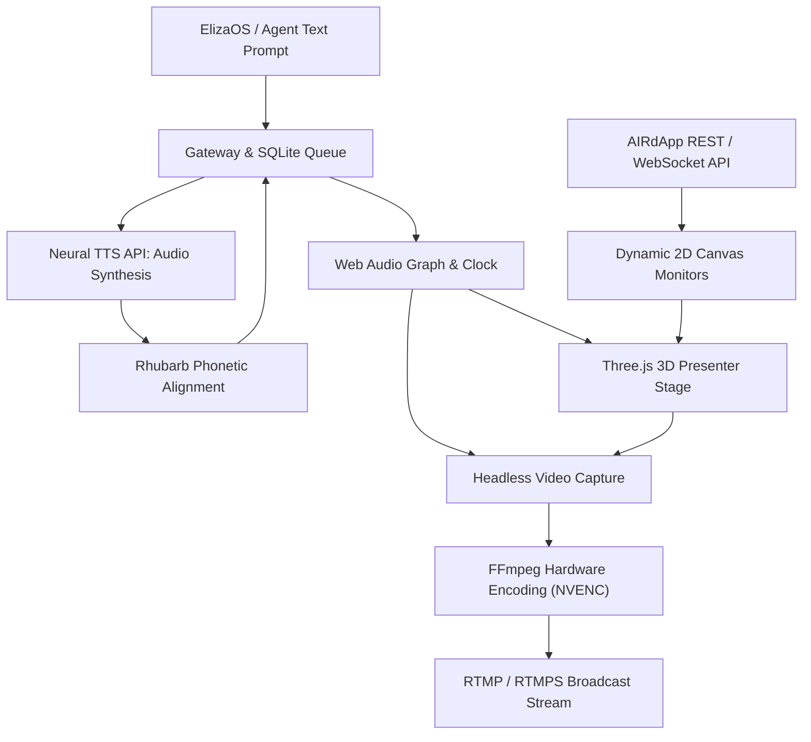

# AIR3 Studio Broadcast Pipeline Architecture

> Note for Live 3.0: The module is standalone. Current production guides are in [STARTUP_LIVE_3.0.md](STARTUP_LIVE_3.0.md) and [LIVE_API_3.0.md](LIVE_API_3.0.md).

The AIR3 broadcasting runtime decouples text intelligence generation (handled by ElizaOS or external agents) from 24/7 video rendering and streaming transmission.

## Pipeline Overview

## 1. WebGL 3D Rendering and Audio Capture

- **Three.js Engine**: Renders the 3D MetaHuman presenter, curved studio walls, instanced acoustic slats, and dynamic video wallboards.
- **Headless Video Capture**: Chromium runs with hardware GPU acceleration. WebGL framebuffers and Web Audio streams are captured via `puppeteer-stream` and piped directly to FFmpeg.
- **FFmpeg Hardware Encoding**: Encodes video to H.264 using **`h264_nvenc`** (NVIDIA RTX 3090) with high-efficiency profile, alongside 48 kHz stereo AAC audio.

## 2. Universal Neural TTS and Phonetic Lip-Sync

- **OpenAI-Compatible Speech API**: The gateway communicates with high-performance neural TTS endpoints (Pocket-TTS / Kokoro / Qwen) via standard `/v1/audio/speech` contracts.
- **Rhubarb Phonetic Alignment**: Synthesized WAV audio is aligned against Rhubarb Lip Sync (1.14.0), generating discrete phoneme intervals (`A` through `H` and silence `X`).
- **Coarticulation**: Morph blendshapes interpolate smoothly on the Web Audio clock, preventing jaw snapping during rapid conversational cadence.

## 3. Autonomous Supervision and Recovery

- **Perpetual Watchdog**: Process supervisors track FFmpeg encoder health, frame rates, and socket connectivity.
- **Exponential Backoff**: Any unexpected stream termination automatically triggers reconnect attempts with exponential backoff (3s to 60s), ensuring continuous 24/7 operation without manual intervention.
