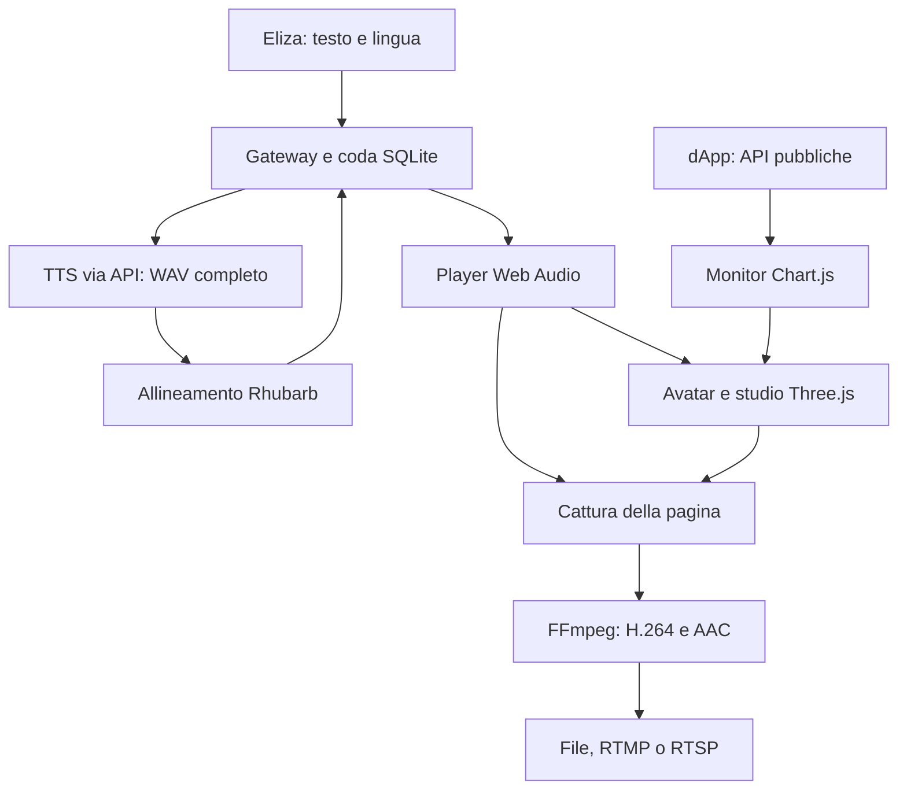

> Nota per Live 3.0: il modulo è ora autonomo. Le istruzioni correnti sono [AVVIO_LIVE_3.0.md](AVVIO_LIVE_3.0.md) e [LIVE_API_3.0.md](LIVE_API_3.0.md). Il testo sottostante documenta l’integrazione e le versioni precedenti.

# Architettura del flusso airewardrop Studio

Questa versione mantiene l'agente che acquisisce informazioni e genera testo e
concentra la presentazione in un servizio autonomo. Il pacchetto contiene il
modello #AIR3, i materiali web, le animazioni corrette, il controllo facciale,
il set televisivo e il percorso di cattura audio/video. La logica di trading e
le integrazioni social restano nei repository ricevuti. Le evidenze della
versione compilata sono indicizzate in [VALIDAZIONE.md](VALIDAZIONE.md).

## 1. Percorso di una narrazione



La pagina usa un motore browser e un grafo audio. I monitor sono canvas
Chart.js caricati come texture della scena. Il servizio può funzionare con
Chromium headless su un server, senza un desktop interattivo o OBS. Renderer
GPU, driver e cattura vanno comunque collaudati sull'host scelto.

Il gateway gestisce testo, sintesi, timeline e autorizzazioni. Il player
possiede il clock della voce. Il broadcaster cattura la pagina pronta e passa
i media a FFmpeg. Il contratto HTTP e JavaScript è in
[INTEGRATION_CONTRACT.md](INTEGRATION_CONTRACT.md).

## 2. Rendering e uscita video

Three.js usa la GPU quando Chromium dispone di accelerazione hardware.
La cattura corrente di `puppeteer-stream` produce WebM VP8/Opus; FFmpeg lo
decodifica e genera H.264/AAC per la destinazione scelta. **Questo percorso
comporta ricodifica.** Non è una pipeline zero-copy e il suo costo complessivo
non è stato confrontato con ogni possibile soluzione nativa.

La configurazione iniziale è 1920×1080 a 30 fps. È un target, non una misura
di throughput acquisita sul server di produzione. La cadenza del file può
includere frame duplicati: i frame realmente renderizzati e la loro età sono
esposti separatamente nei diagnostics.

In modalità automatica FFmpeg prova nell'ordine `h264_nvenc`, `h264_qsv` e
`libx264`, con un'effettiva codifica di prova per ogni candidato. È possibile
richiedere esplicitamente un encoder tramite configurazione. Un encoder NVIDIA funzionante non prova che
WebGL usi la GPU. Il controllo del renderer è separato e l'uscita live richiede
hardware per default, salvo modifica esplicita della relativa configurazione.
Il backend ANGLE e il percorso Chrome possono essere impostati per l'host;
nessun dato di VRAM, consumo o costo mensile è presentato come benchmark.

L'uscita `file` è il default. RTMP e RTSP sono destinazioni di pubblicazione
configurabili; la modalità RTSP invia a un server compatibile già disponibile,
non avvia automaticamente un server RTSP. Istruzioni: [AVVIO.md](AVVIO.md).

### Qualità dello studio

Il set usa illuminazione HDR locale tramite PMREM, materiali PBR, vetro con
trasmissione, riflesso planare del pavimento e bloom contenuto. `high` aggiunge
GTAO e aumenta ombre e risoluzione del riflesso; `balanced` riduce il costo senza
GTAO; `software` disattiva i passaggi più costosi. Il riflesso del pavimento
proviene da una camera speculare. **Non è SSR generalizzato**; il desk usa la
mappa ambientale.

La selezione avviene tramite `AIR3_RENDER_QUALITY` o parametro URL `quality`.
Con `auto`, o senza selezione esplicita, viene scelto `balanced` su hardware e
`software` per SwiftShader/llvmpipe. Il file `.env.example` distribuito imposta
invece `high` esplicitamente. I profili sono descritti in
[STUDIO_RENDERING.md](STUDIO_RENDERING.md).

Questa ricostruzione non implementa Lumen, path tracing o tutti gli shader
proprietari di Unreal. **La parità visiva con Unreal non è verificata.**

## 3. Sintesi vocale sostituibile

La configurazione fornita mantiene la compatibilità con Kokoro attraverso
un endpoint HTTP `/v1/audio/speech`. È un default di integrazione, non una
classifica aggiornata dei provider o una dimostrazione che sia il modello più
veloce. Il servizio TTS residente sulla GPU CUDA è gestito separatamente e
non è incluso come processo del gateway.

URL, chiave API, modello, voci inglese e italiana e velocità sono configurabili.
Un provider alternativo può essere usato se rispetta il formato richiesto:

```json
{
  "model": "kokoro",
  "input": "Testo da leggere",
  "voice": "af_jessica",
  "response_format": "wav",
  "speed": 1
}
```

La lingua del job seleziona la voce configurata. La route Gradio legacy
`/generate_full` non è lo stesso contratto. Prima di cambiare provider occorre
verificare WAV PCM16, frequenza, canali, pronuncia di numeri e ticker e latenza
sui testi reali. Il nome dell'endpoint da solo non prova compatibilità.

Il gateway divide il testo ai confini di frasi/parole, genera i segmenti in
sequenza, valida i WAV e li assembla. L'intera narrazione deve essere sintetizzata
e, se abilitato, allineata prima di diventare riproducibile. **Non è TTS
progressivo.** Il buffering semplifica durata, cancellazione e sincronizzazione;
segmenti più piccoli non implicano una latenza iniziale già ridotta o misurata.

## 4. Lip-sync, emozioni e animazione

La revisione 2.2 conserva [contatto con la camera e micro-espressioni](CAMERA_PRESENCE.md),
le [acconciature selezionabili](CAPELLI_IMPORTATI.md), le [calzature](CALZATURE.md) e
[spostamenti guidati verso i monitor](MOVIMENTO_STUDIO.md) nel [set ovale](STUDIO_OVALE.md).
Il campo opzionale [presentation](PRESENTATION_API.md) associa un comando di
regia al job vocale senza cambiare i producer che lo omettono.

Il gateway esegue Rhubarb 1.14.0 sul WAV completo. Sono forniti gli eseguibili
Linux x64 e Windows x64; `AIR3_RHUBARB_PATH` può selezionare un'installazione
alternativa. Il riconoscitore è `pocketSphinx` per inglese e `phonetic` per
italiano. La timeline contiene intervalli in secondi con una delle nove forme
`A B C D E F G H X`.

| `AIR3_LIPSYNC_MODE` | Comportamento |
| --- | --- |
| `auto` | Prova l'allineamento; in caso di indisponibilità o timeout consegna un fallback di ampiezza esplicitamente etichettato. |
| `required` | Un allineamento non disponibile o scaduto fa fallire il job prima del playback. |
| `off` | Usa direttamente il fallback di ampiezza. |

Il player decodifica il WAV una volta e usa `AudioContext.currentTime` per
riproduzione, avanzamento e forma della bocca. La timeline valida viene
campionata sul clock audio; l'ampiezza del segnale modula l'apertura della
mandibola. Il fallback di ampiezza non produce una sequenza fonetica. La modalità
effettiva compare nei diagnostics e nell'interfaccia operatore.

L'avatar usa **35 controlli scheletrici e 29 correttivi del volto sorgente**.
Le nove forme non sono quindici visemi completi, né equivalgono a un port di
RigLogic. Le animazioni corporee ricevute comprendono tre idle e quattro talk,
con traslazioni corrette rispetto al bind del modello. Il rig coordina corpo,
abiti, testa e accessori e usa punti delle suole per il contatto con il pavimento.
Il controller scenico campiona sette clip di [motion capture ACCAD](MOCAP_LOCOMOZIONE.md) retargettate sul rig effettivo; la pianificazione dei tragitti e la correzione degli appoggi restano nello spazio dello studio. Non è inclusa una simulazione dei vestiti.

Ogni narrazione può indicare `neutral`, `warm`, `happy`, `sad`, `focused`,
`concerned` o `surprised`, con intensità 0–1 e alias italiani. Il metadato guida l'espressione dell'avatar:
**non viene inoltrato come controllo emotivo al TTS**. Il rig aggiunge battiti
di palpebre e piccoli movimenti dello sguardo. Le camere offrono `auto`,
`wide`, `presenter` e `screens`. Non è implementato un regista generativo che
deduca gesti ed emozioni dal significato del testo.

Dettagli e limiti: [AVATAR_QUALITY.md](AVATAR_QUALITY.md) e
[MATERIALI_AVATAR.md](MATERIALI_AVATAR.md).

## 5. Readiness e ciclo di vita

`window.air3Studio.ready` aspetta il primo rendering dello studio e il primo
frame contenente l'avatar configurato, dopo il caricamento dei materiali. Un
GLB configurato ma non caricabile rifiuta la readiness e mostra l'errore di
avvio. Il manichino è disponibile soltanto con URL avatar vuoto. Una perdita
del contesto WebGL o una chiusura durante il caricamento interrompe le promesse
in attesa. La chiusura del renderer rilascia le risorse.

Prima della cattura il broadcaster chiama `armAudio()`: prepara un oscillatore
con guadagno zero per rendere disponibile la traccia audio. `connectPlayer()`
riusa il medesimo grafo. La preview aperta manualmente resta un osservatore
muto e non reclama narrazioni.

Il renderer espone conteggio frame, istante dell'ultimo render, renderer GPU,
profilo, stato dell'avatar e materiali. Il polling di salute gira in un Web Worker
dedicato, con una richiesta in corso e timeout HTTP di quattro secondi.
Il worker separa il controllo di rete dal codice che aggiorna il frame;
non è una garanzia contro la saturazione generale del processo browser.
Resta separato dall'heartbeat della lease audio, che non viene allungata.

## 6. Coda e comportamento ai guasti

SQLite locale contiene la coda e un solo worker genera la voce. Un lock
esclusivo impedisce a due gateway di usare la stessa directory dati.
L'idempotenza vale per ID e contenuto della richiesta, inclusi lingua,
priorità, scadenza ed eventuale emozione. Riutilizzare l'ID con contenuto
diverso produce conflitto; non è deduplicazione globale del testo.

Una sola lease consente il playback. L'heartbeat protegge anche download e
decodifica; il player arresta l'audio quando perde la lease. La cancellazione
viene osservata al controllo successivo e non è istantanea rispetto alla DELETE.
Al riavvio del gateway, i job già leased o playing scadono per evitare di
ripetere parole forse già trasmesse. I job ancora queued o ready possono
proseguire se validi. Non è una garanzia exactly-once fino allo spettatore.

L'adattatore Eliza attende `finished` prima di liberare la sua narrazione.
Sintesi, allineamento, attesa in coda e playback consumano tutti il budget
temporale disponibile. Un controllo sulla durata residua impedisce il claim
di un audio che non può terminare prima della scadenza. Contenuti lunghi
richiedono segmentazione editoriale coerente con i timeout del produttore.

Il broadcaster controlla i buffer Node e può riavviare una sessione in errore.
Questi controlli non impongono un limite assoluto alla memoria interna del
browser. La tenuta continuativa e il recupero dai guasti vanno misurati sul
deployment definitivo.

## 7. Dati e monitor

AIRTrack e auto-trading sono modalità distinte e chiaramente etichettate. Non
è implementata una fusione contabile con il vault. I report AIRTrack e auto
hanno definizioni diverse del cumulativo; non sono presentati come APY o
rendimento del portafoglio. Dati mancanti restano sconosciuti: la pagina non
genera prezzi, trade o rendimenti sostitutivi.

L'adattatore Chart.js disegna candele e livelli Entry/TP/SL senza importare il
bootstrap React della dApp. Riusa tecnologia e contratti dati, non l'identico
componente React `CandlestickChart.tsx`. Il canvas finisce direttamente in una
`CanvasTexture`, senza iframe.

Il socket pubblico `/ws` è usato solo per ricevere; il client non invia messaggi
applicativi. Il reconnect usa backoff. Snapshot e report hanno fallback HTTP
a 30 secondi; le candele vengono richieste ogni 10 secondi. Queste richieste
non superano le cache del backend: età di ricezione e timestamp di mercato
sono grandezze distinte.

Il client Studio non invia ordini né richieste di modifica alla dApp. Alcuni
GET legacy possono però aggiornare cache, etichette o campi derivati nel backend.
La separazione riguarda privilegi e operazioni del client, non l'assenza assoluta
di scritture interne durante una lettura.

## 8. Build e limiti di consegna

Il frontend viene compilato con esbuild in `studio-broadcast/public/build/`.
Three.js e i suoi addon restano dipendenze locali, servite dal servizio. Il
manifest registra input, output e SHA-256; dopo una modifica ai moduli browser
va eseguito `npm run build`. Le istruzioni precedenti secondo cui il progetto
non richiedeva bundling sono conservate soltanto nello storico.

Il caricatore supporta gli asset GLB/glTF locali inclusi. Non è un runtime
VRM specializzato. La ricostruzione web dei materiali e del volto non include
tutti i sistemi Unreal. Il provider CUDA reale, la piattaforma di destinazione
e una prova continuativa sulla GPU finale restano collaudi distinti dalla
compilazione, dai test automatici e dalle prove SwiftShader.

La documentazione ricevuta e i suoi log sono in
[history/imported/](history/imported/). Per la nuova versione usare
[VALIDAZIONE.md](VALIDAZIONE.md) e i report sotto `validation/current/`.

## 8. Regia di luci e aspetto

`StudioLighting` mantiene cinque spot con attenuazione quadratica e i parametri di ambiente/IBL/esposizione. `LookController` coordina caricamenti asincroni dei capelli e delle scarpe, conserva la scelta richiesta durante modifiche concorrenti e ripristina il look precedente in caso di errore. I preset hanno schema chiuso e limiti numerici. `look-controls.mjs` è condiviso fra preview e studio. Il broadcaster legge il preset del pacchetto all’avvio; il browser operatore può applicare una preferenza locale. [Guida](LUCI_E_PRESET.md).
